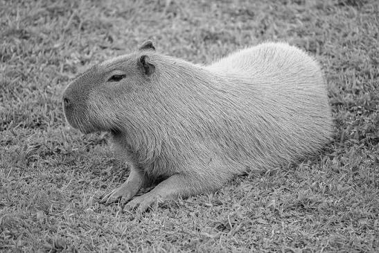
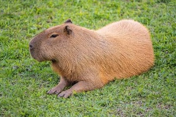
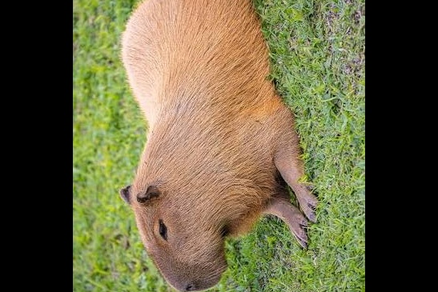
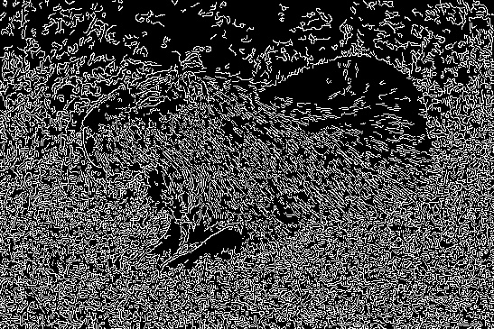
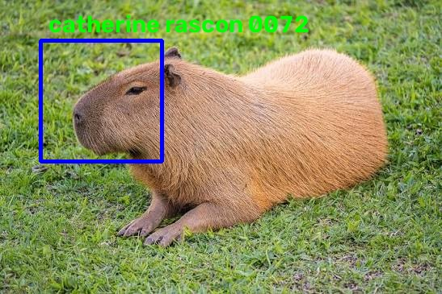
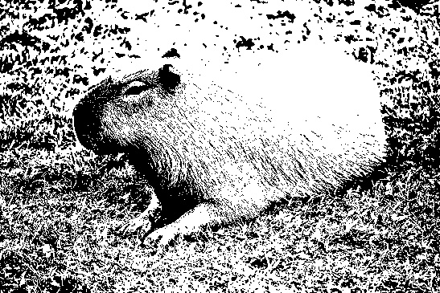
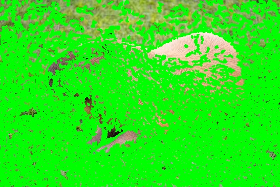

# UIII Act 5 OpenCV Practica Alumno

## 1. Imagen Original 0072

## 2.Escala de grises 0072

## 3. Cambiar el tamaño de la imagen 0072

## 4. Girar la imagen 90 grados. 0072

## 5. Desenfoque de una imagen 0072

## 6. Detección de bordes mediante el algoritmo de Canny 0072

## 7. Dibujar formas y añadir texto 0072

## 8. Umbralización 0072

## 9. Detección de contornos 0072
